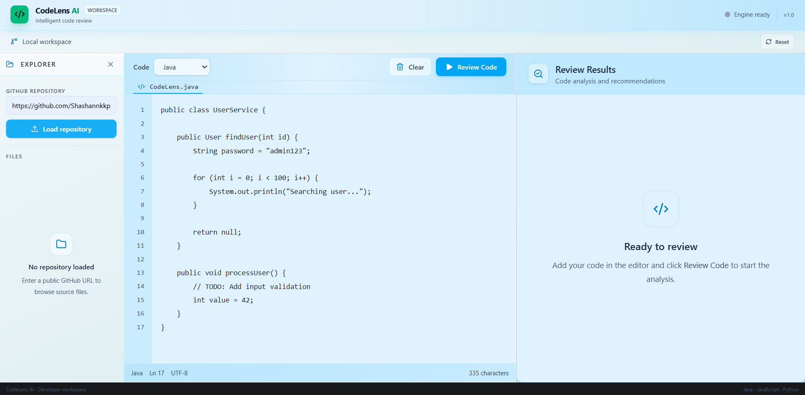
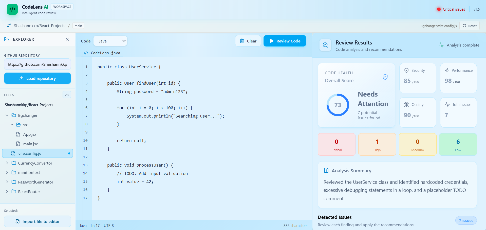

# CodeLens AI

> An AI-powered code review workspace for identifying security vulnerabilities, performance issues, and code-quality problems.

CodeLens AI is a browser-based code review application built with React and Node.js. It combines Google's Gemini API with local rule-based checks to analyze source code, highlight potential issues, suggest improvements, and generate improved code. Developers can write or paste code directly into the editor or import supported source files from public GitHub repositories.

## Showcase

<!-- Replace these placeholders with screenshots from the running app. -->

### Main workspace



<!-- Add a screenshot showing the editor, GitHub explorer, and review panels. -->

### Code review results



<!-- Add a screenshot showing review findings, severity levels, and suggested improvements. -->

## Highlights

- **AI-powered code reviews** using Google's Gemini API.
- **Rule-based analysis** to identify common security, performance, and code-quality issues.
- **Severity-based findings** with issue categories, descriptions, and actionable suggestions.
- **Improved code generation** with an emphasis on preserving the original program logic.
- **GitHub integration** to browse public repositories and import supported source files.
- **Interactive code editor** for writing, pasting, and reviewing source code.
- **REST API backend** with separated frontend and server-side AI integration.
- **Request handling and error management** for GitHub requests and code-review operations.

## Tech Stack

| Layer | Tools |
| --- | --- |
| Frontend | React, Vite |
| Styling | Tailwind CSS |
| Icons | Lucide React |
| Backend | Node.js, Express |
| AI | Google Gemini via `@google/genai` |
| Repository integration | GitHub API |
| API communication | REST APIs, JSON, Fetch API |
| Development tools | Git, GitHub, ESLint |

## Project Structure

```text
codelens-ai/
├── backend/
│   ├── server.js              # Express API and backend routes
│   ├── package.json           # Backend dependencies and scripts
│   └── .env                   # API keys and environment variables
├── screenshots/
│   ├── UI1.png                # Main workspace screenshot
│   └── UI2.png                # Code review results screenshot
├── src/
│   ├── components/            # Workspace and UI components
│   ├── hooks/                 # Reusable React hooks
│   ├── services/              # API and code-review services
│   ├── App.jsx                # Main application component
│   └── ...                    # Other application files
├── index.html
├── package.json
├── vite.config.js
└── README.md
```

## Setup

### Prerequisites

- Node.js and npm
- A Google Gemini API key
- Git (optional, for cloning the repository)

### 1. Clone the repository

```bash
git clone https://github.com/Shashannkkp/codelens-ai.git
cd codelens-ai
```

### 2. Install dependencies

From the project root:

```bash
npm install
cd backend
npm install
```

### 3. Configure environment variables

Create a `.env` file inside the `backend/` directory:

```env
GEMINI_API_KEY=your_gemini_api_key_here
GITHUB_TOKEN=your_github_token_here
PORT=8080
```

`GITHUB_TOKEN` is used for authenticated GitHub API requests when configured. Keep your API keys private and never commit your `.env` file to source control.

### 4. Start the backend

Open a terminal:

```bash
cd backend
npm run dev
```

The API runs at `http://localhost:8080` by default.

### 5. Start the frontend

Open a second terminal from the project root:

```bash
npm run dev
```

Open the local URL shown by Vite, usually `http://localhost:5173`.

## API

### `GET /`

Returns a basic backend health response.

### `POST /api/review`

Analyzes submitted source code using the code-review backend.

The request includes the source code and language. The response contains review information such as a summary, issues, suggestions, and improved code.

### `POST /api/github/repository`

Loads repository information and the supported source files from a GitHub repository.

### `POST /api/github/file`

Retrieves the contents of a selected file from a GitHub repository.

## Available Scripts

Run these from the project root:

| Command | Purpose |
| --- | --- |
| `npm run dev` | Start the Vite development server |
| `npm run build` | Create a production frontend build |
| `npm run preview` | Preview the production build locally |
| `npm run lint` | Run ESLint |

Run `npm run dev` inside `backend/` to start the API server, provided the backend development script is configured in `backend/package.json`.

## Notes

- Gemini API requests are handled by the backend so the API key does not need to be exposed in frontend code.
- CodeLens AI combines local rule-based checks with AI-generated review feedback.
- GitHub integration supports importing supported source files from repositories.
- Repository access, API quotas, and Gemini availability may affect requests.
- The `screenshots/` directory contains the images displayed in this README. Ensure both screenshot files exist before pushing your changes.
- Never commit API keys or other secrets to GitHub.